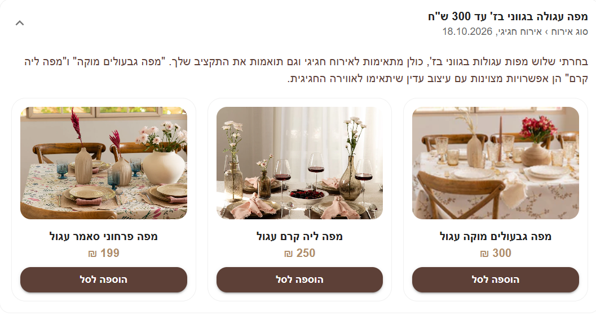

# CasaBella – חנות מפות שולחן עם עוזרת AI לבחירת מפה

חנות אינטרנט מלאה למפות שולחן (קטלוג, עגלת קניות, תשלום וניהול מוצרים למנהלת), שהורחבה במערכת **AI למציאת מפה**:
הלקוחה בוחרת קטגוריה ותת-קטגוריה, מתארת איזו מפה היא מחפשת, וה-AI ממליץ על מפות מתאימות מתוך החנות.
כל בקשה ותשובה נשמרות, כך שלכל לקוחה יש היסטוריית חיפושים, והמנהלת יכולה לעבור על החיפושים של כולן.

המערכת נבנתה כ-MVP קטן לפי מטלת *"AI-Driven Learning Platform"*, באותה ארכיטקטורה
(קטגוריה ← תת-קטגוריה ← פרומפט ← תשובת AI ← היסטוריה ← דשבורד מנהל), בהתאמה לתחום של החנות:
במקום שה-AI יכתוב שיעורים, הוא ממליץ על מוצרים מהקטלוג.

## צילום מסך



## יכולות

**החנות (קיימת)**
- קטלוג מוצרים, עגלת קניות, תשלום והיסטוריית הזמנות
- הרשמה והתחברות עם JWT
- מנהלת: הוספה, עריכה ומחיקה של מוצרים, וצפייה בכל ההזמנות

**עוזרת ה-AI למציאת מפה (חדש)**
- בחירת קטגוריה ותת-קטגוריה (למשל *צורת השולחן › עגול*)
- תיאור חופשי של מה שמחפשים, למשל "מפה עגולה בגווני בז' עד 300 ש"ח"
- ה-AI מחזיר הסבר קצר ועד 3 מוצרים מהחנות, עם כפתור "הוספה לסל"
- היסטוריית חיפושים אישית לכל משתמשת מחוברת
- דשבורד מנהלת: כל המשתמשים (שם, אימייל, טלפון) עם היסטוריית הבקשות שלהם, כולל חיפוש ועימוד
- שדה טלפון בהרשמה

## טכנולוגיות

| שכבה | טכנולוגיות |
|---|---|
| פרונט | React 19, Vite, Redux Toolkit, Material UI, react-hook-form, axios |
| בק | Node.js, Express 5, Mongoose, Joi, JWT, bcryptjs, multer |
| מסד נתונים | MongoDB (כולל קובץ Docker Compose) |
| AI | OpenAI Chat Completions API, או ספק Mock מובנה (ברירת מחדל) |

## מבנה הפרויקט

```
.
├── docker-compose.yml          # MongoDB לפיתוח מקומי
├── CasaBella-Server
│   ├── app.js
│   ├── config/                 # חיבור למסד הנתונים
│   ├── middleware/             # אימות (JWT), בדיקת מנהלת, העלאת תמונות
│   ├── models/                 # משתמשים, מוצרים, הזמנות, קטגוריות, תתי-קטגוריות, פרומפטים
│   ├── controllers/            # טיפול בבקשות (כולל assistant.controller.js)
│   ├── routes/                 # הגדרת נתיבים (כולל assistant.route.js)
│   ├── services/aiService.js   # ממשק ה-AI: Mock + OpenAI
│   ├── seed/                   # קטגוריות, משתמשת מנהלת, מוצרים
│   └── uploads/                # תמונות המוצרים
└── CasaBella-Client
    └── src
        ├── app/                # ה-store של Redux
        ├── components/         # Navbar
        ├── features/           # מוצרים, עגלה, הזמנות, התחברות, עוזרת ה-AI
        └── services/           # קריאות לשרת (auth, assistant)
```

## הרצה מקומית

**דרישות:** Node.js 18 ומעלה, ו-MongoDB (מותקן מקומית או דרך Docker).

### 1. מסד נתונים
```bash
docker compose up -d
```
(אפשר לדלג אם כבר רץ אצלך MongoDB מקומי על פורט 27017.)

### 2. שרת
```bash
cd CasaBella-Server
cp .env.example .env        # ב-PowerShell: copy .env.example .env
npm install
npm run seed                # קטגוריות + משתמשת מנהלת + מוצרים
npm run dev                 # http://localhost:5000
```

### 3. לקוח
```bash
cd CasaBella-Client
npm install
npm run dev                 # http://localhost:5173
```

הלקוח מצפה לשרת בכתובת `http://localhost:5000`.

### התחברות כמנהלת
הפקודה `npm run seed` יוצרת משתמשת מנהלת לפי `ADMIN_EMAIL` ו-`ADMIN_PASSWORD` שבקובץ ה-`.env`
(הרצה חוזרת מאפסת את הסיסמה של אותה משתמשת). אחרי ההתחברות יופיעו בתפריט "הוספת מוצר", "ניהול הזמנות" ו"חיפושי לקוחות".

### משתני סביבה (`CasaBella-Server/.env`)

| משתנה | תיאור |
|---|---|
| `PORT` | הפורט של השרת (ברירת מחדל 5000) |
| `MONGO_URI` | כתובת החיבור ל-MongoDB |
| `JWT_SECRET` | הסוד שבו נחתמים הטוקנים (חובה) |
| `AI_PROVIDER` | `mock` (ברירת מחדל) או `openai` |
| `OPENAI_API_KEY` | נדרש רק כש-`AI_PROVIDER=openai` |
| `OPENAI_MODEL` | אופציונלי, ברירת מחדל `gpt-4o-mini` |
| `ADMIN_EMAIL`, `ADMIN_PASSWORD` | משמשים את `npm run seed` ליצירת המנהלת |

## חיבור ה-AI

כל הגישה ל-AI עוברת דרך פונקציה אחת, `recommendProducts()` בקובץ `services/aiService.js`,
עם שני ספקים שאפשר להחליף ביניהם:

- **Mock (ברירת מחדל, בלי מפתח):** חיפוש מילות מפתח בשמות המוצרים, עם טיפול בסיסי בסופיות בעברית
  (למשל "עגולה" מתאים ל"עגול") וסינון לפי תקציב ("עד 300"). אם אין התאמה, מוחזרים כמה מוצרים מהקטלוג.
- **OpenAI:** מגדירים `AI_PROVIDER=openai` ו-`OPENAI_API_KEY`. השרת שולח את בקשת הלקוחה יחד עם הקטלוג
  (מזהה, שם ומחיר) ומבקש תשובה בפורמט JSON. התשובה עוברת ולידציה: נשמרים רק מזהי מוצרים שבאמת קיימים בחנות,
  יש מגבלת זמן של 20 שניות, ותקלה מחזירה שגיאת 502 ברורה.

## ממשק ה-API

אימות: טוקן JWT נשלח בכותרת `x-auth-token`.

| שיטה | נתיב | הרשאה | תיאור |
|---|---|---|---|
| GET | `/api/assistant/categories` | פתוח | רשימת קטגוריות |
| GET | `/api/assistant/categories/:categoryId/sub-categories` | פתוח | תתי-קטגוריות של קטגוריה |
| POST | `/api/assistant/prompts` | משתמשת מחוברת | גוף הבקשה: `categoryId`, `subCategoryId`, `prompt`. מחזיר את התשובה השמורה עם המוצרים המומלצים |
| GET | `/api/assistant/prompts/me` | משתמשת מחוברת | ההיסטוריה של המשתמשת המחוברת |
| GET | `/api/assistant/admin/users?page=&limit=&search=` | מנהלת | משתמשים עם הבקשות שלהם (עימוד וחיפוש) |
| POST | `/api/users/register`, `/api/users/login` | פתוח | הרשמה והתחברות |
| GET | `/api/products` | פתוח | רשימת מוצרים (POST / PUT / DELETE למנהלת בלבד) |
| — | `/api/orders` | משתמשת / מנהלת | תשלום והזמנות |

## מודל הנתונים

| אוסף | שדות |
|---|---|
| `users` | id, name, email, password (מוצפן), phone, isAdmin |
| `categories` | id, name |
| `sub_categories` | id, name, category_id |
| `prompts` | id, user_id, category_id, sub_category_id, prompt, response, recommendedProducts, created_at |

הקשרים בין האוספים נעשים עם הפניות של Mongoose. תת-קטגוריה ייחודית בתוך הקטגוריה שלה, והשרת בודק
שתת-הקטגוריה שנבחרה אכן שייכת לקטגוריה שנבחרה.

## ולידציה, שגיאות ואבטחה

- גוף הבקשות נבדק עם Joi; קלט שגוי ומזהים לא תקינים מחזירים `400`, ופריט שלא נמצא מחזיר `404`
- אורך הפרומפט מוגבל ל-5 עד 500 תווים (בלקוח ובשרת)
- שגיאות מוחזרות בפורמט `{ "message": ... }`, ושגיאות שרת לא צפויות לא חושפות פרטים פנימיים
- סיסמאות מוצפנות עם bcrypt, ורשימת המשתמשים למנהלת לא מחזירה סיסמאות
- אי אפשר להירשם כמנהלת: השדה `isAdmin` לא מתקבל מהבקשה
- החיפוש במסך המנהלת מנקה את הקלט לפני בניית ביטוי רגולרי
- אין סודות במאגר: `.env` לא עולה ל-Git, ו-`.env.example` מתעד את כל המשתנים

## הנחות

- תיאור הלקוחה הוא טקסט חופשי, והקטגוריות ותתי-הקטגוריות נותנות ל-AI הקשר בלבד
- משתמשת החנות הקיימת היא גם המשתמשת של העוזרת (לטבלת `users` נוסף השדה `phone`)
- בלי מפתח OpenAI האפליקציה רצה במצב Mock, כך שהיא עובדת מיד אחרי ההתקנה
- משתמשים והזמנות אמיתיים לא נכללים במאגר; המנהלת והמוצרים נוצרים על ידי סקריפטי ה-seed

## לא נכלל

בדיקות אוטומטיות, תיעוד Swagger / OpenAPI, TypeScript והעלאה לאינטרנט.